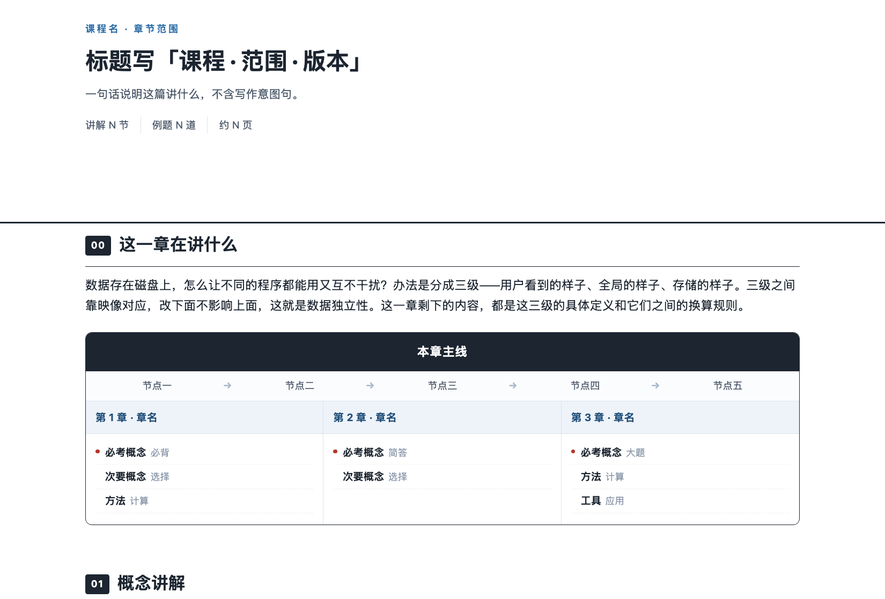

# 📚 卷卷知识点讲解

> 把教材、真题、笔记整理成一篇**能读懂、能照抄、能当模板套**的知识点讲解文章。输出单文件 HTML ＋ A4 可打印 PDF。

一个给 Claude Code / WorkBuddy 用的 Skill。不是"帮我总结一下"，而是"按讲解的逻辑写一篇文章"。



---

## 它要解决的问题

用 AI 写知识总结，九成写成这样：

```
一、数据库的定义
二、数据库系统的特点
  1. 数据结构化
  2. 数据共享性高
三、数据模型
```

这是**目录搬运**。读者拿到的是一堆孤立条目，还得自己建立联系。

这个 Skill 强制换一种写法：先讲这一章要解决什么问题，再讲概念为什么被造出来，然后才是定义。

| | 罗列 | 讲解 |
|---|---|---|
| 顺序 | 定义 1 → 定义 2 → 性质 1 | 要解决什么问题 → 为什么造它 → 定义 → 例子 → 容易混在哪 |
| 读者 | 要自己建立联系 | 顺着读就懂 |
| 例题 | 单独一块题库 | 用来印证概念 |

---

## 核心方法：五问法

每个概念至少回答其中三问，这条是整个 Skill 的质量底线。

1. **它解决什么问题**／为什么需要它
2. **正式定义**（教材或考卷原话）
3. **一个最小例子**
4. **和最容易混的那个概念差在哪**
5. **考试怎么问**

只答第 2 问＝罗列。答了 1 和 4＝讲解。

---

## 输出骨架：五段

```
00 这一章在讲什么   7 句讲清主线 + 演进图 + 知识点图谱
01 概念讲解         一节一个概念组，五问法          ← 占一半篇幅
02 例题             题目 + 完整答案 + 左代码右解释   ← 当模板背
03 考点与易错       分值分布 + 错法对照
04 一页速记         数字、口诀、勾选清单
```

篇幅按可用时间裁剪：3 小时只留 00/01/04，半天五段全上但例题压到 5 个。

**如果例题比讲解厚，说明写成了题库，不是文章。**

---

## 例题只有一种格式

左边是代码，右边是这一行在干什么，同一行水平对齐。

| 代码 | 这一行在干什么 |
|---|---|
| `CREATE TABLE Student (` | **CREATE TABLE ＋ 表名 ＋ 括号**：建表的固定骨架。这里表名就是 **Student** |
| `    Sno CHAR(9) PRIMARY KEY,` | 一行三样：**列名** Sno → **类型** CHAR(9)（定长 9 位）→ **约束** PRIMARY KEY（主码）。顺序不能反 |

对比两种常见写法为什么不行：

- **语法模板 + 参数说明表**：两处信息要来回跳，且模板脱离题目没意义
- **代码 + 下方箭头注释**：眼睛上下扫，找不到哪句注释对应哪一行

第三种之所以对：代码行和解释行在同一条水平线上，视线不跳跃。右栏还顺手完成"通用写法 → 这里填了什么"的换算，这正是做题时脑子里的动作。

---

## 安装

```bash
git clone https://github.com/dxkjuanjuan/juanjuan-knowledge.git

# WorkBuddy
cp -r juanjuan-knowledge ~/.workbuddy/skills/

# Claude Code
cp -r juanjuan-knowledge ~/.claude/skills/
```

新开一个会话即可。触发语：「把第 3 章写成知识点讲解」「整理成能打印抄写的笔记」「把这一章的概念讲明白」。

---

## 文件结构

```
juanjuan-knowledge/
├── SKILL.md                 定位、五问法、五段骨架、硬规则、反面清单
├── references/
│   ├── structure.md         五段逐段怎么写（含完整讲解节范本）
│   ├── formatting.md        四种版式与语言规范
│   └── html-craft.md        打印坑、质检四关、可复制命令
├── assets/
│   └── template.html        15KB 单文件模板，复制即用
└── LICENSE
```

---

## 三个反直觉的设计取舍

**1. 定义必须用原话，不许转述。**
转述会让读者在考场上写不出踩分点。蓝框里放教材原句，灰字放白话，红字放考点——三层分工，各管一件事。

**2. 例题给完整答案，不留空。**
用途是当模板背，不是当练习做。留空会让人卡在"我不会"上，而模板能让他先记住形状。

**3. 不考的章节整节删，不给正文。**
时间不够时最有效的省力方式，是按分值排序后整节砍掉，只在图谱里留个节点。每节删一半反而两头不讨好。

---

## 环境要求

- 生成 HTML：无依赖
- 导出 PDF：Chrome / Chromium（`--print-to-pdf`）
- 质检分页：`pdftoppm`（poppler）

`assets/template.html` 里的 CSS 已处理过动画白页、表格列宽塌陷、双栏表错位这几个坑，直接复制即可。

---

## License

MIT。文章内容（`references/` 下的示例文字）可随意改写使用。
